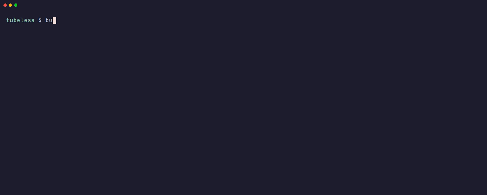
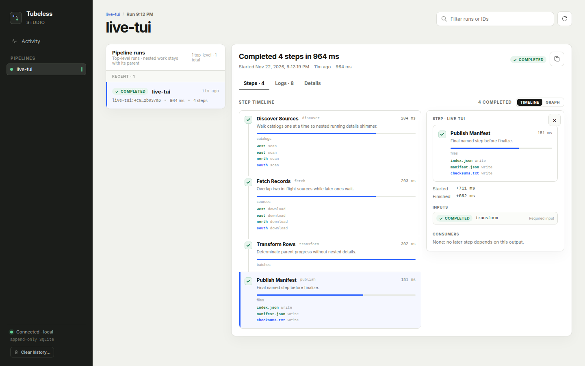

<p align="center">
  <a href="https://tubeless.io/">
    
  </a>
</p>
<h1 align="center">Tubeless</h1>
<p align="center">
  Typed, agentic pipelines for TypeScript. Run locally, schedule on <a href="https://cloud.tubeless.io">Tubeless Cloud</a>.
</p>
<p align="center">
  <a href="https://www.npmjs.com/package/tubeless"></a>
  <a href="https://www.npmjs.com/package/tubeless"></a>
  <a href="https://github.com/chetmancini/tubeless/actions/workflows/check.yml"></a>
  <a href="./LICENSE"></a>
  <a href="./docs/getting-started.md#install"></a>
</p>
<p align="center">
  <br>
  
</p>

Each step's output is the next step's typed input. `plan()` lists the steps that will run, and does not run them. A dry run still runs unmarked steps and skips a write marked `dryRun: "skip"`. The same file runs in your process or on Tubeless Cloud.

## Quick start

Node.js 22.18 or later. The library is ESM-only, has no runtime dependencies, and runs the TypeScript below directly. Linux and macOS are supported; Windows is untested. The project needs `"type": "module"`. The `tubeless` command needs Bun 1.3.14 or later on `PATH`, including when npm or npx starts it. This snippet does not. Tubeless is pre-1.0, so the public API may change between releases.

```sh
mkdir import-rows && cd import-rows
npm init -y
npm pkg set type=module
npm install tubeless
```

`import.ts`:

```ts
import { createSteps, definePipeline } from "tubeless";

interface ImportOptions {
  lines: readonly string[];
}

const { step } = createSteps<ImportOptions>();

const load = step("load", {
  run: (_inputs, context) => context.options.lines,
});

const normalize = step("normalize", {
  dependsOn: [load],
  run: ({ load: rows }) => rows.map((row) => row.trim().toLowerCase()).filter(Boolean),
});

const ImportPipeline = definePipeline({
  id: "import",
  steps: [load, normalize],
});

const rows = await ImportPipeline.runOrThrow({ lines: [" Alpha ", "", "Beta"] });
console.log(rows);
```

```sh
node import.ts
```

Prints `[ 'alpha', 'beta' ]`, the last step's output. Walkthrough: [getting started](./docs/getting-started.md).

## Why Tubeless

A few `await` calls need no library. A pipeline helps when steps pass values along and you want to inspect the run.

- TypeScript checks each handoff. Definitions reject a missing dependency, a duplicate id, or a cycle.
- `plan()` lists selected steps and does not run handlers. `dryRun: "skip"` holds a write back. Unmarked steps still run in a dry run.
- The terminal reporter, Mermaid, and [Studio](./docs/studio.md) show progress and recorded runs. The library stays in your process.
- The same pipeline runs inside [Airflow](./docs/airflow.md), [Temporal](./docs/temporal.md), [Inngest](./docs/inngest.md), [Dagster](./docs/dagster.md), or [Step Functions](./docs/step-functions.md).

| You need                                          | Use                                                                        |
| ------------------------------------------------- | -------------------------------------------------------------------------- |
| A few ordered or parallel calls                   | `await` and `Promise.all`                                                  |
| A typed graph you can plan and dry-run in-process | Tubeless                                                                   |
| Sleeps, retries, and resume after a crash         | [Trigger.dev](https://trigger.dev/) or [Inngest](https://www.inngest.com/) |
| This kind of graph, in Python                     | [Apache Hamilton](https://hamilton.apache.org/)                            |

Trigger.dev and Inngest are durable job platforms. Tubeless does not resume a step after the process exits. Call `runOrThrow` from one of their steps when you need both. Hamilton turns ordinary Python functions into a dataflow. Tubeless is TypeScript, with explicit `dependsOn` edges, `plan()`, dry-run policy, a CLI, and Studio. [Comparison](./docs/comparison.md).

## Plan, draw, Studio, and skills

```ts
const plan = ImportPipeline.plan({ dryRun: true });
console.log(ImportPipeline.toMermaid({ direction: "LR" }));
```

```ts
const publish = step("publish", {
  dependsOn: [normalize],
  dryRun: "skip",
  run: ({ normalize: rows }) => rows.length,
});
```

`plan()` does not run handlers. With `publish` in the pipeline, `plan({ dryRun: true })` sets its `skipReason` to `"dry-run"`. See [publish with gates](./examples/publish-with-gates.ts). `tubeless plan` and `tubeless graph` print the same preview.
Studio needs Bun. From this repository, the commands behind the pictures above are:

```sh
bunx tubeless run --store .tubeless/runs.sqlite examples/live-tui.ts -- --delay 200
bunx tubeless ui --store .tubeless/runs.sqlite
```

They serve [http://127.0.0.1:4317](http://127.0.0.1:4317). A browser launch needs a schema-backed pipeline or `definePipelineCommand`. The quick start is library-only. [Studio guide](./docs/studio.md).
`npx skills add chetmancini/tubeless` installs authoring skills, not the runtime. [Skill pack](./docs/agent-skills.md).

## Run it on Tubeless Cloud, free

[Tubeless Cloud](https://cloud.tubeless.io) runs these files from a GitHub repository. Each run is its own Cloudflare Worker. Start one from a cron line in `.tubeless/crontab`, a push, the dashboard, `tubeless cloud run`, the HTTP API, or [MCP](https://cloud.tubeless.io/docs/agents.md). The free plan is one person, 100 execution minutes, and 100 runs a month. No credit card. A run stops at 5 minutes of elapsed time or 10 seconds of CPU. If Tubeless is useful, [star the repository](https://github.com/chetmancini/tubeless). Stars help the next person find it.

## Documentation

[Website](https://tubeless.io/) · [Getting started](./docs/getting-started.md) · [CLI](./docs/cli.md) · [GitHub Action](./docs/github-action.md) · [Studio](./docs/studio.md) · [Concepts](./docs/concepts.md) · [Comparison](./docs/comparison.md) · [Recipes](./docs/recipes.md) · [API](./docs/api-reference.md) · [Issues](https://github.com/chetmancini/tubeless/issues) · [Contributing](./CONTRIBUTING.md) · [Security](./SECURITY.md) · [MIT](./LICENSE)
